# Déroulé pas à pas

Ce document suit le TP dans l'**ordre chronologique**. Pour chaque étape : l'objectif, ce qui a été fait, ce que montre la capture (les **cadres rouges numérotés** renvoient aux points listés sous chaque image) et ce qu'il faut en retenir. Toutes les heures sont en **UTC** (l'horloge de la VM avance d'une heure).

Image de référence : **essai 2** (simulation de 16:33 à 16:35 UTC le 18/10/2026). Les essais 1 et 3 servent à comprendre le bonus (étape 11).

---

## Étape 0 — Préparer un état de départ propre

- Snapshot `Before_S3_NTFS` de la VM **éteinte** (17/10/2026, 15:45:08 UTC). Un snapshot « à chaud » écrit la RAM sur un disque externe et peut rester bloqué ; à froid il prend une seconde.
- Le support de collecte est un dossier partagé VirtualBox, monté en `E:` dans la VM. Toutes les écritures vont sur ce support, jamais sur le `C:` de la victime.
- Avant chaque essai, la VM est restaurée à ce snapshot.

## Étape 1 — Simuler les six actions

Le script [`simulation_S3.ps1`](../scripts/simulation_S3.ps1) crée un dossier, crée un fichier, le modifie, le renomme, crée un second fichier puis le supprime, en notant l'heure UTC de chaque action dans `verite_terrain.txt` (écrit sur le support).

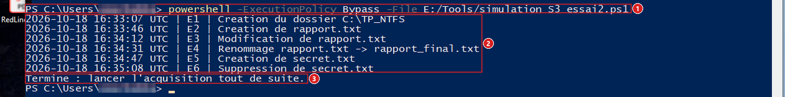

1. La commande, lancée dans un PowerShell **non administrateur**.
2. Les six lignes E1 à E6 avec leur heure : 16:33:07, 16:33:46, 16:34:12, 16:34:31, 16:34:47, 16:35:08.
3. Le message final qui demande de lancer l'acquisition aussitôt.

> À retenir : on **connaît** la vérité terrain ; le but est de retrouver chaque action dans les journaux.

## Étape 2 — Acquérir l'image du disque et la vérifier

FTK Imager, en administrateur : *Create Disk Image*, *Physical Drive* `\\.\PHYSICALDRIVE0`, format **E01**, destination sur le support, **Verify images after they are created** coché.

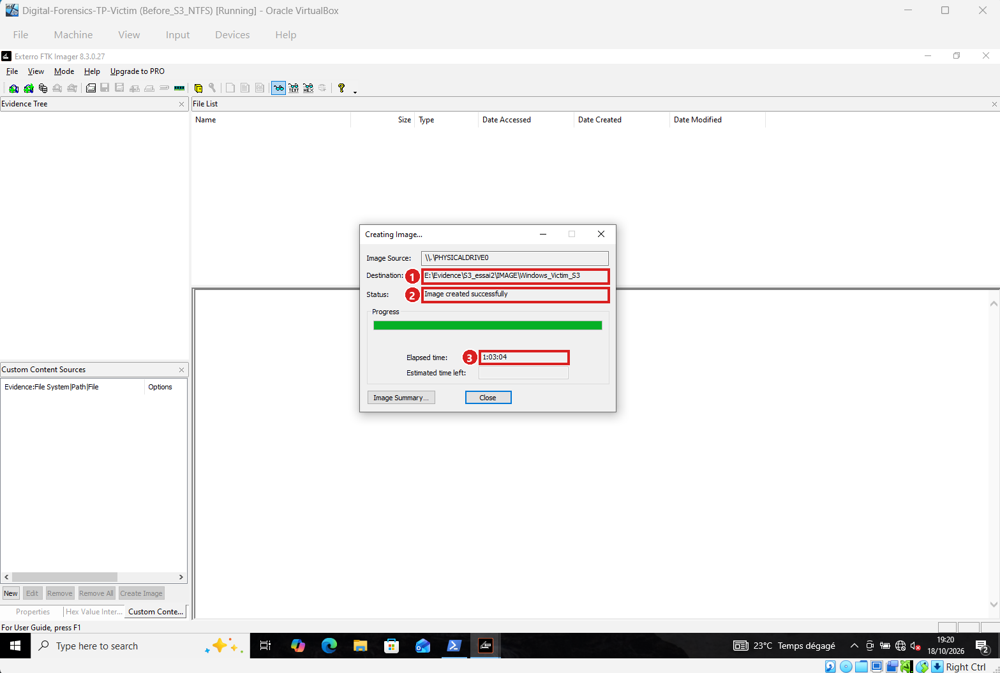

1. Destination `E:\Evidence\S3_essai2\IMAGE\Windows_Victim_S3` (sur le support, pas sur la victime).
2. Statut **« Image created successfully »**.
3. Durée : 1 h 03 min 04 s.

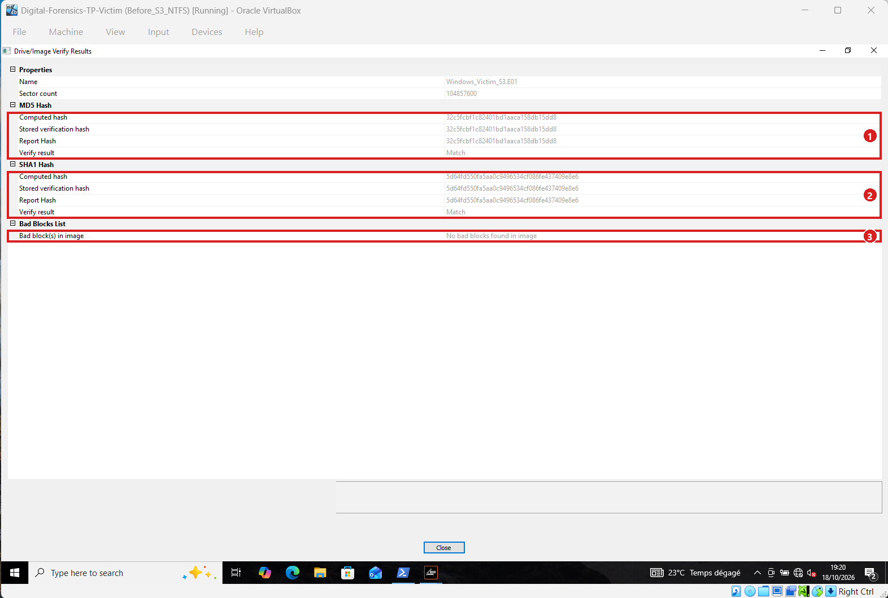

1. **MD5** : valeur calculée = valeur stockée = valeur du rapport (`32c5fcbf…15dd8`), résultat **Match**.
2. **SHA-1** : les trois valeurs sont identiques (`5d64fd55…e8e6`), **Match**.
3. **Aucun bad block**.

> À retenir : l'image est une copie fidèle du disque. Sans cette vérification, rien de ce qui suit n'aurait de valeur de preuve.

## Étape 3 — Ouvrir l'image et repérer les métafichiers NTFS

Sur le poste d'analyse : FTK Imager, *Add Evidence Item*, *Image File*. Les métafichiers sont à la racine de la partition principale.

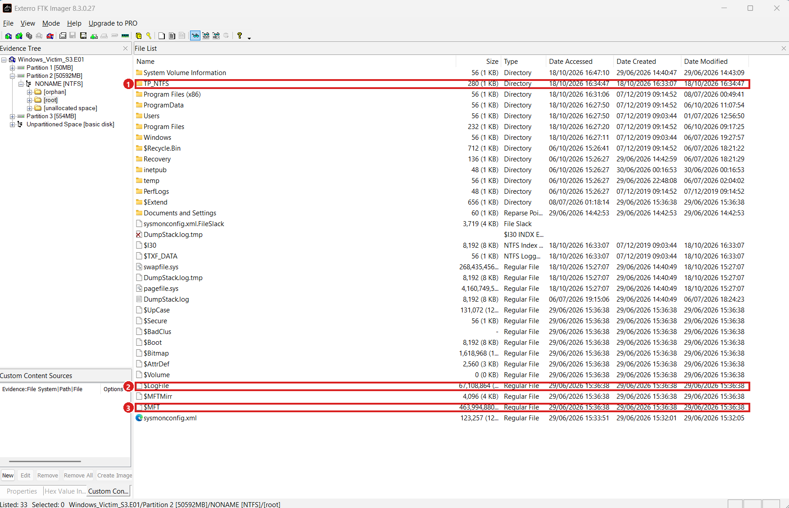

1. Le dossier `TP_NTFS`, créé le 18/10/2026 à 16:33:07 : c'est bien l'image de l'essai 2.
2. `$LogFile` : 67 108 864 octets (64 Mo).
3. `$MFT` : 463 994 880 octets.

`$MFT` et `$LogFile` sont exportés par *clic droit, Export Files…* vers `NTFS_ORIG`.

## Étape 4 — Exporter le journal USN (flux `$J`)

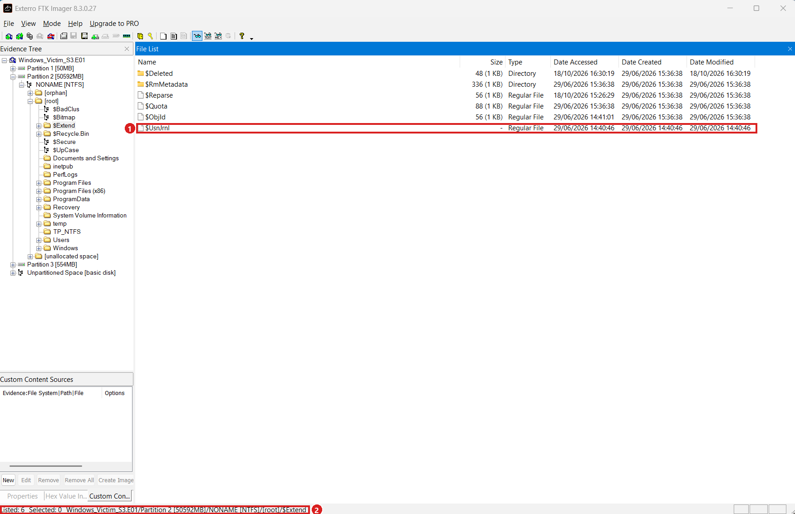

1. `$UsnJrnl` est listé avec une taille « - » : son flux principal est vide.
2. Chemin affiché en bas : `.../[root]/$Extend`.

Le journal est dans un **flux de données alternatif** `$J`. Il s'affiche quand on sélectionne `$UsnJrnl` **dans l'arbre**.

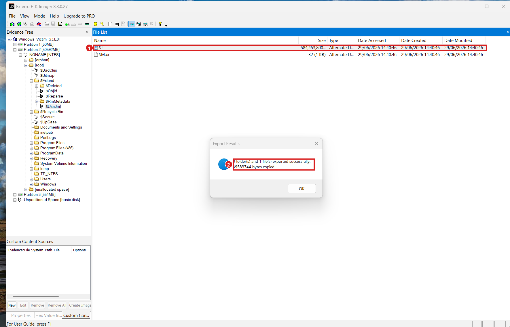

1. Le flux `$J` (taille logique 584 453 800 octets) à côté de `$Max`.
2. **« 1 file(s) exported successfully. 39583744 bytes copied »** : le flux est *sparse*, seule la partie allouée est copiée.

> `$J` a été exporté deux fois par erreur : FTK a nommé le second `$J.copy0`. Les SHA-1 sont identiques ; le doublon est rangé à part.

## Étape 5 — Protéger les preuves : attributs, copies de travail, hash

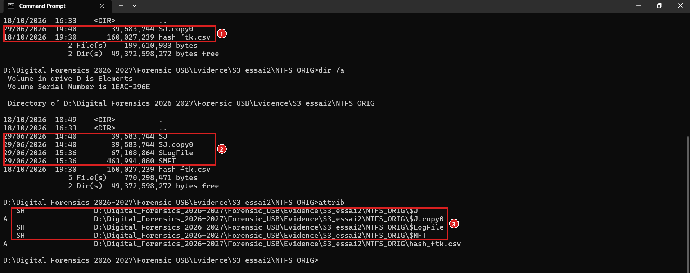

1. `dir` : `$MFT`, `$LogFile` et `$J` sont **absents**.
2. `dir /a` : ils sont **présents**, avec leurs tailles exactes.
3. `attrib` : **`S H`** devant chacun (Système + caché).

Les métafichiers NTFS sont système et cachés, et `dir` masque ce type de fichier par défaut. Ensuite :

- originaux mis en **lecture seule** (`attrib +r +s +h`) ;
- **copies de travail** dans `TRAVAIL` (attributs ordinaires) : c'est sur elles que travaille NTFS Log Tracker ;
- comparaison des SHA-1 :

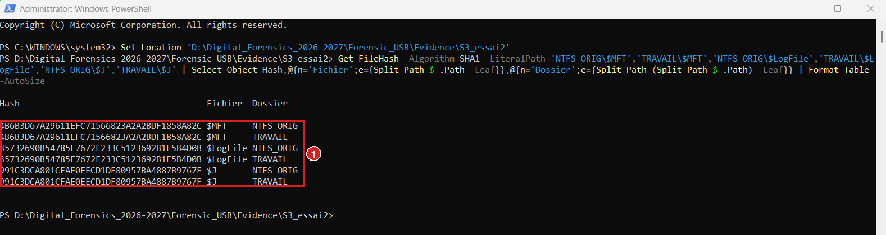

1. Pour chaque fichier, **le même hash** dans `NTFS_ORIG` et dans `TRAVAIL` (`$MFT` `4B6B3D67…`, `$LogFile` `35732690…`, `$J` `991C3DCA…`). Ils sont aussi égaux à ceux de la liste de hash de FTK.

## Étape 6 — Parser avec NTFS Log Tracker

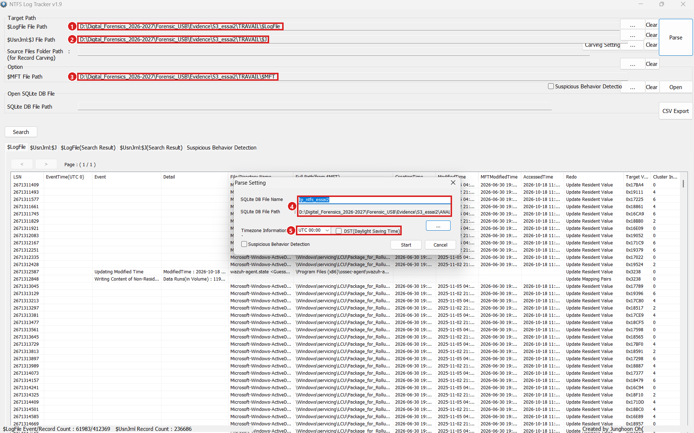

1. `$LogFile File Path` : la **copie de travail** de l'essai 2.
2. `$UsnJrnl:$J File Path` : idem.
3. `$MFT File Path` : idem.
4. Base `tp_ntfs_essai2` dans `ANALYSE`.
5. Fuseau **UTC 00:00**, DST décoché.

> Piège rencontré : en ouvrant cette fenêtre, les trois chemins du haut pointaient encore vers l'essai 1 (valeurs gardées d'une session précédente). Les compteurs identiques à l'essai 1 l'ont révélé ; les chemins ont été corrigés et le parsing refait.

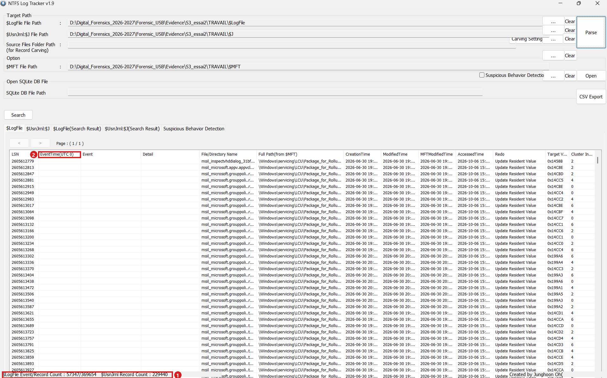

1. Compteurs : **`$LogFile` 57 347 / 369 654** et **`$UsnJrnl` 229 440**. Ils diffèrent de ceux de l'essai 1 : ce sont de nouvelles données.
2. Colonne **EventTime(UTC 0)** : les heures sont en UTC.

## Étape 7 — Lire `$UsnJrnl:$J` (première source)

Recherche par nom dans la section `$UsnJrnl`, onglet `$UsnJrnl:$J(Search Result)`.

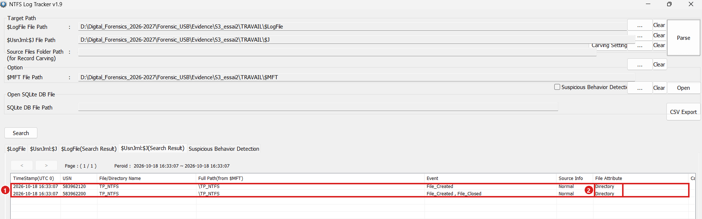

1. Deux lignes à **16:33:07** : `File_Created`, puis `File_Created, File_Closed`.
2. *File Attribute* = **Directory** : c'est ce qui prouve que `TP_NTFS` est un dossier.

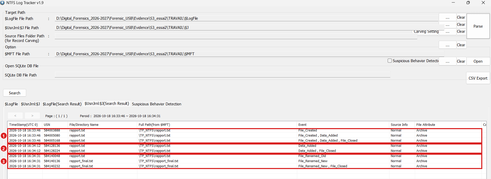

1. **16:33:46** : `File_Created`, `Data_Added`, `File_Closed` : création (E2).
2. **16:34:12** : `Data_Added` **sans** `File_Created` : modification (E3).
3. **16:34:31** : `File_Renamed_Old` (`rapport.txt`) puis `File_Renamed_New` (`rapport_final.txt`) : renommage (E4). Le numéro MFT (32881) ne change pas : c'est le même fichier.

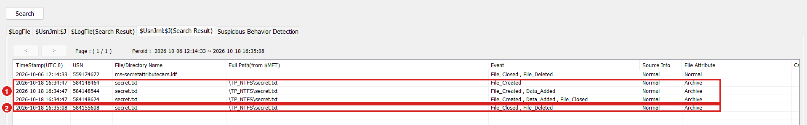

1. **16:34:47** : `File_Created`, `Data_Added`, `File_Closed` (E5).
2. **16:35:08** : `File_Closed, File_Deleted` (E6). Le fichier a existé 21 secondes.

## Étape 8 — Recouper avec `$LogFile` (deuxième source)

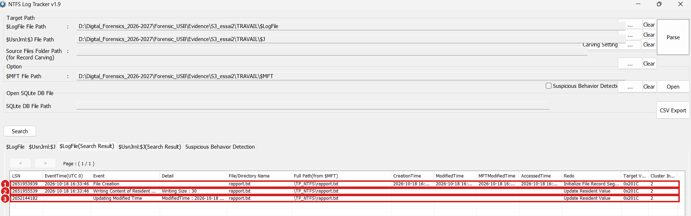

1. **16:33:46** : *File Creation*.
2. **16:33:46** : *Writing Content of Resident File*, **Writing Size : 30** (28 caractères + retour à la ligne).
3. *Updating Modified Time* de 16:33:46 à 16:34:12 : la modification E3.

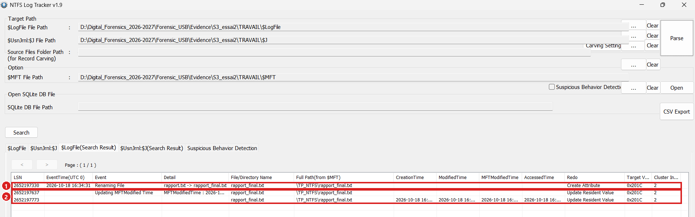

1. **16:34:31** : *Renaming File*, `rapport.txt -> rapport_final.txt`.
2. Mises à jour de la MFT juste après.

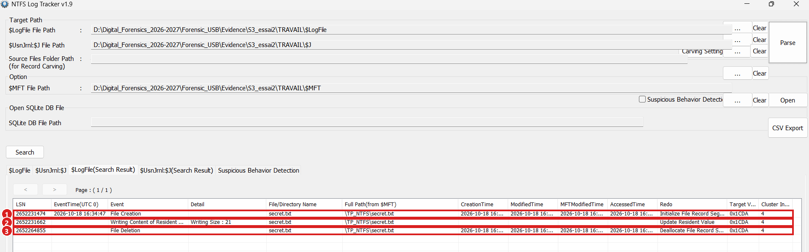

1. **16:34:47** : *File Creation*.
2. *Writing Content of Resident File*, **Writing Size : 21**.
3. *File Deletion* : l'entrée MFT est libérée.

> Les trois sources (script, `$UsnJrnl`, `$LogFile`) concordent à la seconde : voir [`rendu/chronologie.md`](../rendu/chronologie.md).

## Étape 9 — Ce que voit FTK Imager (Q7)

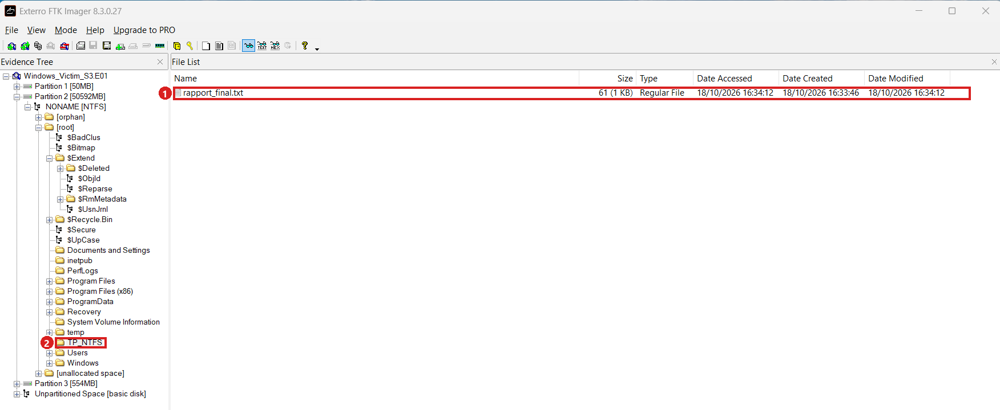

1. Un seul fichier : **`rapport_final.txt`** (61 octets, créé 16:33:46, modifié 16:34:12).
2. Le dossier `TP_NTFS` sélectionné, sans entrée supprimée dans la liste.

`secret.txt` n'apparaît **pas**, même marqué comme supprimé : son entrée MFT a été réattribuée.

## Étape 10 — Chronologie et réponses

Tableau de chronologie et recoupement : [`rendu/chronologie.md`](../rendu/chronologie.md). Réponses Q1 à Q8, bonus et conclusion : [`rendu/questions.md`](../rendu/questions.md).

## Étape 11 — Le bonus : retrouver le texte de `secret.txt`

L'énoncé suppose qu'on lit « Code d'acces : 4589 » dans `$LogFile`. Trois essais, trois résultats :

- **Essai 1** : acquisition 81 minutes après la suppression. `$LogFile` (journal circulaire de 64 Mo) est **entièrement réécrit** : aucune trace de `TP_NTFS`, `rapport` ni `secret`. `$UsnJrnl` et `$MFT` gardent les six actions.
- **Essai 2** : acquisition 9 min 26 s après. `$LogFile` est lisible, mais le **texte** est absent : balayage de toute l'image (51 200 Mo) = **0 occurrence** (ASCII et UTF-16).
- **Essai 3** : acquisition lancée **10 secondes** après la suppression, avec FTK préparé avant le script.

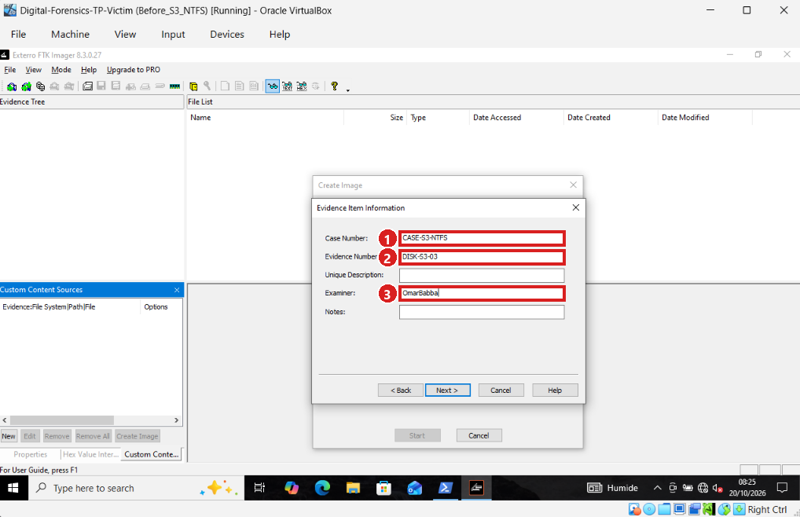

1. `CASE-S3-NTFS`. 2. `DISK-S3-03` (distinct de l'essai 2). 3. Examinateur.

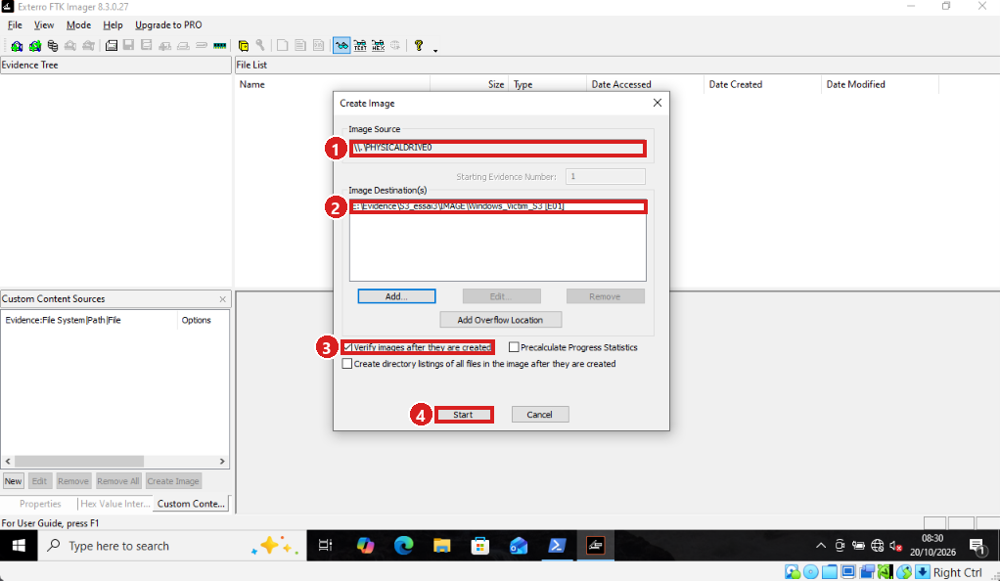

1. Source : disque physique. 2. Destination `...\S3_essai3\IMAGE\Windows_Victim_S3 [E01]`. 3. **Verify** coché. 4. **Start** pas encore cliqué : la copie ne doit commencer qu'après le script.

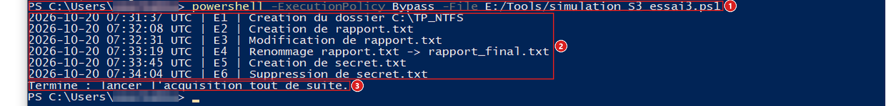

1. Commande. 2. Les six lignes, de 07:31:37 à 07:34:04 UTC. 3. Message final.

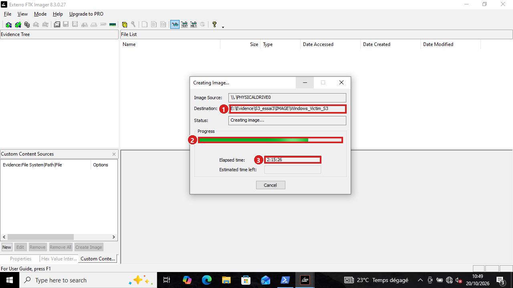

1. Destination de l'essai 3. 2. Progression. 3. Temps écoulé : **2:15:26**.

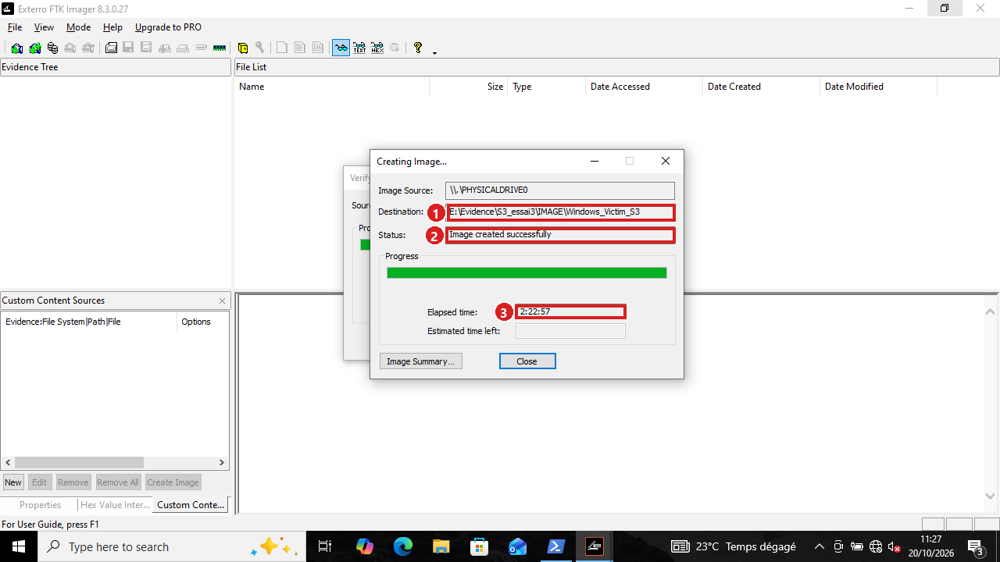

1. Destination. 2. **« Image created successfully »**. 3. Durée : **2:22:57**.

> La copie a pris 2 h 23 (contre 1 h 03 à l'essai 2) : la VM a gelé à plusieurs reprises parce que le disque externe, qui porte à la fois le disque virtuel lu et l'image écrite, était saturé. L'image a été terminée normalement.

### Pourquoi le texte est introuvable

- **L'image n'est pas un instantané.** FTK lit le disque pendant 1 à 2 heures. Le délai qui compte est le moment où la zone `$MFT` / `$LogFile` (à environ 3 Go du début du disque) est lue : ≈ 84 min, ≈ 16 min et ≈ 8 min après la suppression pour les essais 1, 2 et 3 (estimation par interpolation).
- **L'entrée MFT est réutilisée en quelques secondes.** Le texte d'un fichier de 21 octets est stocké *dans* son entrée MFT. Le journal USN montre qu'un fichier temporaire de Windows reprend cette entrée **54 s** (essai 1), **3 s** (essai 2) et **14 s** (essai 3) après la suppression : le texte est écrasé avant toute acquisition possible.
- **`$LogFile` ne contient pas le texte.** L'enregistrement de l'écriture de `secret.txt` déclare 21 octets mais ne contient pas ces octets (idem pour `rapport.txt`, 30 octets). C'est un constat, pas une explication.

> Le **fait** de l'écriture et de la suppression est prouvé (noms, heures, tailles, numéro MFT) ; le **contenu** ne l'est pas. Je n'ai pas testé d'autres versions de Windows.

## Étape 12 — Conclusion

- `$UsnJrnl` dit **quoi et quand** ; `$LogFile` ajoute le **comment** ; le numéro MFT relie les lignes d'un même fichier.
- Un fichier supprimé laisse des traces parce que NTFS n'efface rien : il libère l'entrée MFT et note l'événement dans ses journaux.
- Le **contenu** d'un petit fichier, lui, disparaît presque aussitôt.
- Règle pratique : acquérir vite, avoir le bon fuseau, travailler sur des copies, et se demander *quand* chaque zone du disque a été lue.
